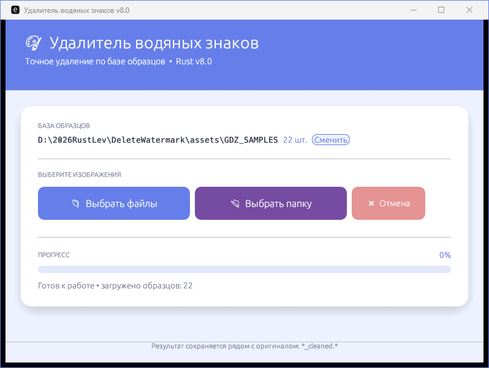

<div align="center">

# 🎨 Delete Watermark v8.0

**Rust port of `DeleteSuper6.py` — precise watermark removal for Windows, Linux, macOS and Android**

[](https://github.com/AmazingCoderA/DeleteWatermark/actions/workflows/build.yml)
[](https://github.com/AmazingCoderA/DeleteWatermark/releases)
[](LICENSE)

[Русская версия](README_RU.md) · [Download APK](https://github.com/AmazingCoderA/DeleteWatermark/releases/download/v8.0.0/delete-watermark.apk) · [Releases](https://github.com/AmazingCoderA/DeleteWatermark/releases)

</div>



## ✨ Highlights

- **One executable.** The web UI, icon logic and processing engine are compiled into the binary. The only external thing is the `GDZ_SAMPLES/` templates folder.
- **GUI by default.** Double-click the exe and you are in. CLI and Web modes are available via `--mode`.
- **Pixel-precise removal.** The mask is built from the shape of the watermark itself (Otsu + background-aware threshold + 2 px antialias dilation), not from a rectangle. Neighbouring text stays untouched.
- **No OpenCV / Python required.** Pure Rust: `image` + FFT template matching (`TM_CCOEFF_NORMED`) + integral images + Telea-style inpainting.
- **Cross-platform.** Windows, Linux, macOS, and a real installable APK for Android.
- **Sample base included.** 22 templates in the root and 8 more in `GDZ_SAMPLES/extra/` — the exact base from the original Python project.

## 🚀 Quick start

```bash
# GUI (default on desktop)
./delete-watermark

# Batch CLI
./delete-watermark --mode cli --input photo.png
./delete-watermark --mode cli --input ./GDZ --output ./GDZ_cleaned

# Web UI on the LAN
./delete-watermark --mode web --port 5000
# open http://127.0.0.1:5000  or  http://<your-ip>:5000 from a phone
```

Maximum accuracy:

```bash
./delete-watermark --mode cli --precise --input photo.png
```

`--precise` disables the speed pyramid (full-resolution search), raises the match threshold to 0.82 and keeps the tightest possible mask. In a test where a watermark sat directly next to two other text blocks, those blocks had **zero changed pixels**.

## ⚙️ Options

| Flag | Meaning | Default |
|------|---------|---------|
| `--mode <cli\|web\|gui>` | Run mode | `gui` on desktop, `cli` without GUI / on Android |
| `--samples <DIR>` | Template database folder | auto-detected `GDZ_SAMPLES` |
| `--input <PATH>` | File or folder to process (repeatable, CLI only) | — |
| `--output <DIR>` | Output folder (CLI only) | next to the original |
| `--precise` | Maximum accuracy, tight glyph mask | off |
| `--threshold <0..1>` | Template match threshold | `0.75` |
| `--nms <FLOAT>` | Non-max suppression overlap | `0.3` |
| `--scale-min / --scale-max / --scale-steps` | Scale search range | `0.6 / 1.4 / 25` |
| `--inpaint-radius <N>` | Inpainting radius | `7` |
| `--pyramid <1..4>` | `1` = exact full-res, `2` = fast default, `3` = very fast | `2` |
| `--list-samples` | Print loaded templates and exit | off |
| `--host / --port` | Web server bind | `0.0.0.0 / 5000` |

The template folder is resolved in this order: `--samples` → `WATERMARK_SAMPLES` env var → `<exe dir>/assets/GDZ_SAMPLES` → `<cwd>/assets/GDZ_SAMPLES` → `<exe dir>/GDZ_SAMPLES` → `<cwd>/GDZ_SAMPLES`. You can also change it from the GUI with the **Сменить** button.

## 📦 Build

```bash
cargo build --release                          # GUI + CLI + Web
cargo build --release --no-default-features    # headless CLI + Web (no GTK/X11)
```

Ready-made autobuild scripts:

| Platform | Command | Result |
|----------|---------|--------|
| Windows | `build.bat` | `dist\delete-watermark-v8.0-windows-x86_64.zip` |
| Linux / macOS | `./build.sh` | `dist/delete-watermark-v8.0-<os>-<arch>.tar.gz` |
| Headless server | `./build.sh headless` | same archive, no GUI dependencies |
| Android APK | `bash android/build_apk.sh` | `build_apk/delete-watermark.apk` |
| Termux (on device) | `bash build_termux.sh` | installs `delete-watermark` + `delete-watermark-web` |

`.github/workflows/build.yml` builds Windows, Linux, macOS and Android on every push and publishes all artifacts plus the APK in a GitHub Release when a `v*` tag is pushed.

## 🤖 Android APK

Install the signed APK from the [release page](https://github.com/AmazingCoderA/DeleteWatermark/releases):

```bash
adb install -r delete-watermark.apk
```

The app starts the Rust engine as an embedded web server and shows the same UI in a WebView. The template base is copied from the APK into the app's private storage on first launch. Min SDK 24, arm64-v8a, target SDK 36.

## 🧠 How it works

1. Templates are loaded as 8-bit grayscale (OpenCV `COLOR_BGR2GRAY` weights).
2. Each template is searched at 25 scales (`np.linspace(0.6, 1.4, 25)`) using FFT-based normalized cross-correlation.
3. Detections are filtered with NMS (overlap 0.3).
4. For every detection, the template's own ink mask is pasted at that position — this is what protects neighbouring text.
5. Masked pixels are reconstructed with a Telea-style inpainting that propagates colour along edges.

The default `--pyramid 2` runs the correlation on a half-resolution image and verifies candidates at full resolution; it is about 4× faster with the same result.

## 📁 Repository layout

```
src/            engine, FFT matcher, image ops, web server, GUI, embedded HTML
assets/
  GDZ_SAMPLES/  the sample database (the only external data at runtime)
android/        WebView shell, manifest, APK build script
docs/           screenshot.png
.github/        autobuild / release workflow
```

## 📄 License

MIT — see [LICENSE](LICENSE). The sample template base is included from the original Python project as an example.
