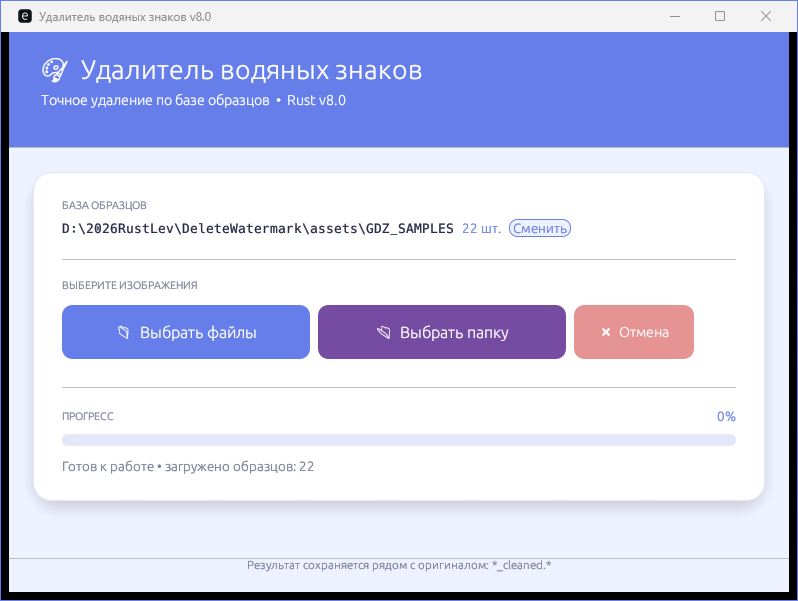

<div align="center">

# 🎨 Удалитель водяных знаков v8.0

**Rust-порт `DeleteGdzSuper6.py` — точное удаление водяных знаков на Windows, Linux, macOS и Android**

[](https://github.com/AmazingCoderA/DeleteWatermark/actions/workflows/build.yml)
[](https://github.com/AmazingCoderA/DeleteWatermark/releases)
[](LICENSE)

[English version](README.md) · [Скачать APK](https://github.com/AmazingCoderA/DeleteWatermark/releases/download/v8.0.0/delete-watermark.apk) · [Релизы](https://github.com/AmazingCoderA/DeleteWatermark/releases)

</div>



## ✨ Что внутри

- **Один исполняемый файл.** Веб-интерфейс, движок и вся логика зашиты в бинарник. Внешняя папка только одна — `GDZ_SAMPLES/` с шаблонами.
- **GUI по умолчанию.** Запустили exe — сразу окно. Режимы `cli` и `web` доступны через `--mode`.
- **Ювелирное удаление.** Маска строится по форме самого знака (Оцу + порог от цвета фона + 2 px на сглаженные края), а не прямоугольником. Соседний текст не трогается.
- **Без OpenCV и Python.** Чистый Rust: `image`, FFT-корреляция (`TM_CCOEFF_NORMED`), интегральные изображения и инпейнтинг в духе Telea.
- **Кроссплатформенно.** Windows, Linux, macOS и настоящий устанавливаемый APK для Android.
- **База образцов включена.** 22 шаблона в корне и ещё 8 в `GDZ_SAMPLES/extra/` — та же база, что была в оригинальном Python-проекте.

## 🚀 Быстрый старт

```bash
# GUI (по умолчанию на десктопе)
./delete-watermark

# Пакетная обработка
./delete-watermark --mode cli --input photo.png
./delete-watermark --mode cli --input ./GDZ --output ./GDZ_cleaned

# Веб-интерфейс в локальной сети
./delete-watermark --mode web --port 5000
# откройте http://127.0.0.1:5000 или http://<ваш-ip>:5000 с телефона
```

Максимальная аккуратность:

```bash
./delete-watermark --mode cli --precise --input photo.png
```

`--precise` отключает пирамиду (поиск идёт в полном разрешении), поднимает порог до 0.82 и оставляет самую узкую маску по пикселям знака. В тесте, где водяной знак стоял вплотную к двум другим надписям, у тех надписей изменилось **ноль пикселей**.

## ⚙️ Флаги

| Флаг | Назначение | По умолчанию |
|------|-----------|--------------|
| `--mode <cli\|web\|gui>` | Режим работы | `gui` на ПК, `cli` без GUI / на Android |
| `--samples <ПАПКА>` | База образцов | автопоиск `GDZ_SAMPLES` |
| `--input <ПУТЬ>` | Файл или папка (можно повторять, только cli) | — |
| `--output <ПАПКА>` | Папка результатов (только cli) | рядом с оригиналом |
| `--precise` | Максимальная точность, маска по знаку | выключено |
| `--threshold <0..1>` | Порог совпадения шаблона | `0.75` |
| `--nms <FLOAT>` | Порог перекрытия NMS | `0.3` |
| `--scale-min / --scale-max / --scale-steps` | Диапазон масштабов | `0.6 / 1.4 / 25` |
| `--inpaint-radius <N>` | Радиус инпейнтинга | `7` |
| `--pyramid <1..4>` | `1` — точно в полный рост, `2` — быстро по умолчанию, `3` — очень быстро | `2` |
| `--list-samples` | Вывести список образцов и выйти | выключено |
| `--host / --port` | Адрес веб-сервера | `0.0.0.0 / 5000` |

Папка образцов ищется так: `--samples` → переменная `WATERMARK_SAMPLES` → `<папка exe>/assets/GDZ_SAMPLES` → `<текущая папка>/assets/GDZ_SAMPLES` → `<папка exe>/GDZ_SAMPLES` → `<текущая папка>/GDZ_SAMPLES`. В GUI базу можно сменить кнопкой **Сменить**.

## 📦 Сборка

```bash
cargo build --release                          # GUI + CLI + Web
cargo build --release --no-default-features    # только CLI + Web, без GTK/X11
```

Готовые скрипты автосборки:

| Платформа | Команда | Результат |
|-----------|---------|-----------|
| Windows | `build.bat` | `dist\delete-watermark-v8.0-windows-x86_64.zip` |
| Linux / macOS | `./build.sh` | `dist/delete-watermark-v8.0-<os>-<arch>.tar.gz` |
| Headless-сервер | `./build.sh headless` | архив без GUI-зависимостей |
| Android APK | `bash android/build_apk.sh` | `build_apk/delete-watermark.apk` |
| Termux (на устройстве) | `bash build_termux.sh` | `delete-watermark` + `delete-watermark-web` |

`.github/workflows/build.yml` собирает все платформы при каждом push и публикует артефакты вместе с APK в GitHub Release по тегу `v*`.

## 🤖 APK для Android

Подписанный APK лежит на [странице релиза](https://github.com/AmazingCoderA/DeleteWatermark/releases):

```bash
adb install -r delete-watermark.apk
```

Приложение поднимает Rust-движок как встроенный веб-сервер и показывает тот же интерфейс в WebView. База образцов копируется из APK в приватное хранилище приложения при первом запуске. Min SDK 24, arm64-v8a, target SDK 36.

## 🧠 Как это работает

1. Шаблоны загружаются в 8-битный оттенок серого (веса OpenCV `COLOR_BGR2GRAY`).
2. Каждый шаблон ищется в 25 масштабах (`np.linspace(0.6, 1.4, 25)`) через FFT-корреляцию.
3. Обнаружения фильтруются NMS (перекрытие 0.3).
4. Для каждого обнаружения накладывается маска именно чернил шаблона — вот это и сохраняет соседний текст.
5. Пиксели под маской восстанавливаются инпейнтингом в духе Telea с распространением цвета вдоль рёбер.

Режим `--pyramid 2` по умолчанию считает корреляцию на половинном разрешении, а кандидатов проверяет в полном — примерно в 4 раза быстрее при том же результате.

## 📁 Структура

```
src/            движок, FFT, работа с изображениями, веб-сервер, GUI, вшитый HTML
assets/
  GDZ_SAMPLES/  база образцов — единственные внешние данные в рантайме
android/        WebView-оболочка, манифест, скрипт сборки APK
docs/           screenshot.png
.github/        autobuild и публикация релиза
```

## 📄 Лицензия

MIT — см. [LICENSE](LICENSE). База шаблонов включена из оригинального Python-проекта как пример.
